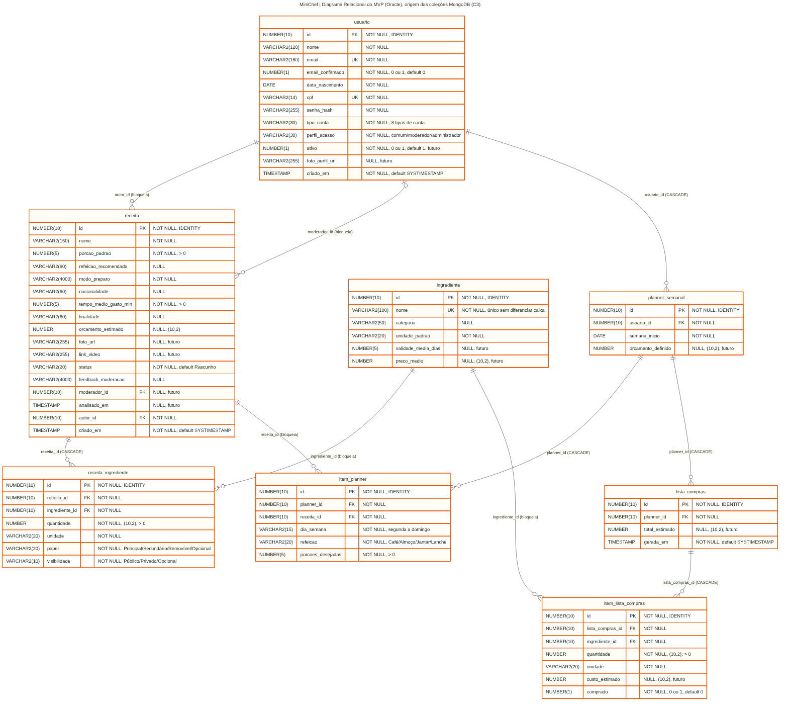

# MiniChef | Banco de Dados Não Relacional (MongoDB)

**Trabalho C3 da disciplina de Banco de Dados.** Continuação direta da C2: o mesmo MVP do MiniChef. O banco relacional de origem roda no Oracle da VM da disciplina, como pede o item 4 do edital, e os dados são migrados para o MongoDB.

**Grupo:** Carlos Henrique Forechi, Cesar Augusto e Gabriel Bitti.

---

## Sumário

1. Objetivo
2. Da C2 para a C3
3. Decisões de modelagem
4. Diagrama relacional
5. Coleções
6. Integridade entre coleções
7. Regras de negócio
8. Consultas e relatórios
9. Como criar e migrar o banco
10. Resultados esperados
11. Checklist de entrega
12. Critérios de avaliação

---

## 1. Objetivo

O MiniChef é um app de organização alimentar para quem cozinha, no dia a dia ou no trabalho. O MVP tem quatro funções:

| Função | O que faz |
|---|---|
| CRUD de receitas | Cadastrar, consultar, alterar e remover receitas com seus ingredientes |
| Planner semanal | Distribuir receitas pelos dias e refeições da semana |
| Calculadora de porções | Ajustar as quantidades de cada ingrediente ao número de porções desejado |
| Lista de compras | Somar os ingredientes do planner e gerar a lista automaticamente |

Na C3, o programa da C2 continua o mesmo para o usuário: mesmo menu, mesmas entidades e mesmos relatórios. Muda o banco. Cada tabela vira uma coleção do MongoDB, e cada comando SQL do código passa a ser um comando do driver oficial do MongoDB.

---

## 2. Da C2 para a C3

### Tabela vira coleção, com o mesmo nome

| Tabela relacional (Oracle) | Coleção na C3 (MongoDB) | Referencia |
|---|---|---|
| `usuario` | `usuario` | (nenhuma) |
| `ingrediente` | `ingrediente` | (nenhuma) |
| `receita` | `receita` | `usuario` (autor e moderador) |
| `receita_ingrediente` | `receita_ingrediente` | `receita`, `ingrediente` |
| `planner_semanal` | `planner_semanal` | `usuario` |
| `item_planner` | `item_planner` | `planner_semanal`, `receita` |
| `lista_compras` | `lista_compras` | `planner_semanal` |
| `item_lista_compras` | `item_lista_compras` | `lista_compras`, `ingrediente` |

São 8 coleções, e 6 delas têm relacionamento. O edital exige no mínimo 2.

### Linha vira documento, com os mesmos campos

| Tipo no Oracle | Tipo no MongoDB | Cuidado na migração |
|---|---|---|
| `NUMBER(10)` com `IDENTITY` (chave) / `NUMBER(5)` | `int` | Nenhum: o driver `oracledb` devolve número |
| `VARCHAR2` | `string` | Nenhum |
| `NUMBER(1)` com 0 ou 1 (o Oracle não tem BOOLEAN) | `bool` | Converter 1 em `true` e 0 em `false` |
| `DATE` / `TIMESTAMP` | `date` | Nenhum: o driver devolve `Date` |
| `NUMBER(10,2)` | `double` | Nenhum: o driver devolve número |
| `NULL` | `null` | Campos futuros continuam presentes, com `null` |

O driver `oracledb` devolve os nomes de coluna em maiúsculas (`NOME`). A função `linhaOracleParaDocumento(colecao, linha)`, em `src/mongo/colecoes.js`, faz as duas conversões: nomes em minúsculas e booleanos.

### Comando SQL vira comando do driver

| Na C2 | Na C3 |
|---|---|
| `SELECT ... WHERE` | `find(filtro)` |
| `SELECT COUNT(1)` | `countDocuments(filtro)` |
| `INSERT` | `insertOne(documento)` |
| `UPDATE ... SET` | `updateOne(filtro, { $set: campos })` |
| `DELETE` | `deleteOne(filtro)` / `deleteMany(filtro)` |
| `GROUP BY` | `aggregate([{ $group: ... }])` |
| `JOIN` | `aggregate([{ $lookup: ... }])` |
| `FOREIGN KEY` | Não existe. O programa confere os filhos antes de remover (seção 6) |

---

## 3. Decisões de modelagem

### Referência ou documento embutido

| Opção | Prós | Contras | Recomendação |
|---|---|---|---|
| **Referência: uma coleção por tabela, o filho guarda o `id` do pai** | Atende o item 4 do edital (coleção com o nome de cada tabela). Reaproveita todo o código da C2. Mantém o CRUD de cada entidade | Relatório com junção precisa de `$lookup` | **Sim** |
| Embutir os itens dentro do pai (ex.: ingredientes dentro da receita) | Leitura da receita em uma consulta só | Foge do item 4 do edital. Obriga a reescrever inserir, remover e atualizar de todas as entidades filhas | Não |

### Identificador

| Opção | Prós | Contras | Recomendação |
|---|---|---|---|
| **Manter o campo `id` inteiro da C2. O `_id` do MongoDB existe, mas o programa não usa** | Migração direta. Menus listam números curtos. Referências iguais às da C2 | Novo `id` calculado pelo programa (maior `id` + 1) | **Sim**. É a mesma estratégia do projeto de exemplo do professor |
| Usar só o `_id` (ObjectId) | Gerado pelo MongoDB | Referências viram ObjectId. O usuário teria que digitar códigos de 24 caracteres | Não |

### Validação dos documentos

| Opção | Prós | Contras | Recomendação |
|---|---|---|---|
| **Validador `$jsonSchema` em cada coleção, com os mesmos NOT NULL e CHECK da C2** | O banco recusa documento incompleto ou com valor fora da lista, como na C2 | Exige converter os booleanos `NUMBER(1)` na migração | **Sim** |
| Sem validação | Mais simples | Qualquer erro do programa grava lixo no banco | Não |

---

## 4. Diagrama relacional

O edital pede o diagrama relacional, mesmo sendo um banco não relacional. É o mesmo modelo da C2, escrito com os tipos do Oracle (`src/sql/`), porque cada tabela virou uma coleção.



Arquivos: `src/diagrams/diagrama_relacional_minichef.png`, `.pdf` e a fonte Mermaid `.mmd`.

---

## 5. Coleções

Todas as coleções têm o campo `id` (inteiro, único, obrigatório). **[FUTURO]** marca campo reservado para as próximas fases do MiniChef: ele existe no documento com valor `null` no MVP, então o banco não precisa mudar quando a função chegar.

### `usuario`
| Campo | Tipo | Obrigatório | Regra |
|---|---|---|---|
| `id` | int | sim | único |
| `nome` | string | sim | até 120 caracteres |
| `email` | string | sim | único |
| `email_confirmado` | bool | sim | |
| `data_nascimento` | date | sim | |
| `cpf` | string | sim | único |
| `senha_hash` | string | sim | |
| `tipo_conta` | string | sim | um dos 8 tipos de conta |
| `perfil_acesso` | string | sim | comum, moderador ou administrador |
| `ativo` | bool | sim | [FUTURO] inativar em vez de excluir |
| `foto_perfil_url` | string | não | [FUTURO] |
| `criado_em` | date | sim | |

### `ingrediente`
| Campo | Tipo | Obrigatório | Regra |
|---|---|---|---|
| `id` | int | sim | único |
| `nome` | string | sim | **único sem diferenciar maiúsculas** ("Tomate" = "tomate") |
| `categoria` | string | não | |
| `unidade_padrao` | string | sim | |
| `validade_media_dias` | int | não | [FUTURO] despensa |
| `preco_medio` | double | não | [FUTURO] orçamento |

### `receita`
| Campo | Tipo | Obrigatório | Regra |
|---|---|---|---|
| `id` | int | sim | único |
| `nome` | string | sim | |
| `porcao_padrao` | int | sim | maior que 0 |
| `refeicao_recomendada` | string | não | |
| `modo_preparo` | string | sim | |
| `nacionalidade` | string | não | |
| `tempo_medio_gasto_min` | int | sim | maior que 0 |
| `finalidade` | string | não | |
| `orcamento_estimado` | double | não | |
| `foto_url`, `link_video` | string | não | [FUTURO] |
| `status` | string | sim | Rascunho, Em Análise, Publicada, Recusada ou Arquivada |
| `feedback_moderacao` | string | não | |
| `moderador_id` | int | não | [FUTURO] referência a `usuario.id` |
| `analisado_em` | date | não | [FUTURO] |
| `autor_id` | int | sim | referência a `usuario.id` |
| `criado_em` | date | sim | |

### `receita_ingrediente`
| Campo | Tipo | Obrigatório | Regra |
|---|---|---|---|
| `id` | int | sim | único |
| `receita_id` | int | sim | referência a `receita.id` |
| `ingrediente_id` | int | sim | referência a `ingrediente.id` |
| `quantidade` | double | sim | maior que 0 |
| `unidade` | string | sim | |
| `papel` | string | sim | Principal, Secundário, Removível ou Opcional |
| `visibilidade` | string | sim | Público, Privado ou Opcional |

### `planner_semanal`
| Campo | Tipo | Obrigatório | Regra |
|---|---|---|---|
| `id` | int | sim | único |
| `usuario_id` | int | sim | referência a `usuario.id` |
| `semana_inicio` | date | sim | |
| `orcamento_definido` | double | não | [FUTURO] |

### `item_planner`
| Campo | Tipo | Obrigatório | Regra |
|---|---|---|---|
| `id` | int | sim | único |
| `planner_id` | int | sim | referência a `planner_semanal.id` |
| `receita_id` | int | sim | referência a `receita.id` |
| `dia_semana` | string | sim | segunda a domingo |
| `refeicao` | string | sim | Café da manhã, Almoço, Jantar ou Lanche |
| `porcoes_desejadas` | int | sim | maior que 0 |

### `lista_compras`
| Campo | Tipo | Obrigatório | Regra |
|---|---|---|---|
| `id` | int | sim | único |
| `planner_id` | int | sim | referência a `planner_semanal.id` |
| `total_estimado` | double | não | [FUTURO] |
| `gerada_em` | date | sim | |

### `item_lista_compras`
| Campo | Tipo | Obrigatório | Regra |
|---|---|---|---|
| `id` | int | sim | único |
| `lista_compras_id` | int | sim | referência a `lista_compras.id` |
| `ingrediente_id` | int | sim | referência a `ingrediente.id` |
| `quantidade` | double | sim | maior que 0 |
| `unidade` | string | sim | |
| `custo_estimado` | double | não | [FUTURO] |
| `comprado` | bool | sim | |

**Exemplo de documento** da coleção `receita` (dados ilustrativos):

```json
{
  "id": 1,
  "nome": "Arroz soltinho",
  "porcao_padrao": 4,
  "refeicao_recomendada": "Almoço",
  "modo_preparo": "Refogue alho e cebola no azeite...",
  "nacionalidade": "Brasileira",
  "tempo_medio_gasto_min": 25,
  "finalidade": "dia a dia",
  "orcamento_estimado": 6.5,
  "foto_url": null,
  "link_video": null,
  "status": "Publicada",
  "feedback_moderacao": null,
  "moderador_id": null,
  "analisado_em": null,
  "autor_id": 2,
  "criado_em": "2026-10-19T00:00:00Z"
}
```

---

## 6. Integridade entre coleções

O MongoDB não tem chave estrangeira. Por isso, antes de remover um documento, o programa conta os filhos em cada coleção que aponta para ele (edital 7.c.5.i). A regra de cada relacionamento é a mesma da C2:

| Ao remover | Coleção filha | Campo | Regra |
|---|---|---|---|
| `usuario` | `receita` | `autor_id` | **Bloqueia**: avisa que não pode remover |
| `usuario` | `receita` | `moderador_id` | **Bloqueia** |
| `usuario` | `planner_semanal` | `usuario_id` | **Cascata**: pergunta se remove junto |
| `ingrediente` | `receita_ingrediente` | `ingrediente_id` | **Bloqueia** |
| `ingrediente` | `item_lista_compras` | `ingrediente_id` | **Bloqueia** |
| `receita` | `receita_ingrediente` | `receita_id` | **Cascata** |
| `receita` | `item_planner` | `receita_id` | **Bloqueia** |
| `planner_semanal` | `item_planner` | `planner_id` | **Cascata** |
| `planner_semanal` | `lista_compras` | `planner_id` | **Cascata** (e os itens da lista) |
| `lista_compras` | `item_lista_compras` | `lista_compras_id` | **Cascata** |

Fluxo no programa:
1. `verificarFilhos(db, colecao, id)` devolve os filhos encontrados.
2. Se algum tiver regra **Bloqueia**, o programa informa e não remove.
3. Se só houver **Cascata**, o programa pergunta se remove os filhos. Se a resposta for "Sim", chama `removerComFilhos(db, colecao, id)`.

**Inserção:** antes de inserir um filho, o programa confere se o pai existe (`countDocuments({ id })` na coleção pai). Sem isso, o MongoDB aceitaria um `receita_id` que não existe.

---

## 7. Regras de negócio

### Calculadora de porções

**quantidade ajustada = quantidade base × porções desejadas ÷ porção padrão**

- Unidade: a mesma da receita. Não há conversão (g continua g).
- Arredondamento: 2 casas decimais na exibição.
- O resultado é calculado na consulta e não é gravado.

Exemplo ilustrativo: arroz 400 g, receita para 4 porções, planner pede 8 porções: 400 × 8 ÷ 4 = **800 g**.

### Lista de compras

| Regra | Decisão |
|---|---|
| Soma | Quantidades ajustadas de todas as receitas do planner, por ingrediente e unidade |
| Papel "Opcional" | Não entra. "Removível" entra |
| Unidades contáveis (`unidade`, `dente`) | Arredondam para cima |
| Demais unidades | 2 casas decimais |
| Unidades diferentes do mesmo ingrediente | Linhas separadas, sem conversão |
| Despensa e preço | Fora do MVP. `custo_estimado` e `total_estimado` ficam `null` |

---

## 8. Consultas e relatórios

Todas estão prontas em `src/mongo/consultas.js`, usando só o driver oficial `mongodb`, como o edital exige.

| Função | Equivale na C2 a | Uso no menu |
|---|---|---|
| `contarDocumentos(db)` | `SELECT COUNT(1)` de cada tabela | Tela inicial (edital 6.d) |
| `receitasPorRefeicao(db)` | R1, `GROUP BY` | Relatório de agrupamento (7.a.1.i) |
| `fichaIngredientes(db)` | R2, `JOIN` de 4 tabelas | Relatório de junção (7.a.1.ii) |
| `ingredientesMaisUsados(db)` | R3, `GROUP BY` com `JOIN` | Relatório extra |
| `plannerSemanal(db, plannerId)` | R4, planner de segunda a domingo | Relatório extra |
| `calculadoraPorcoes(db, plannerId)` | Calculadora | Função do MVP |
| `gerarListaCompras(db, plannerId)` e `listaGerada(db, listaId)` | Geração da lista | Função do MVP |
| `proximoId(db, colecao)` | `IDENTITY` | Inserir documentos |
| `listarDocumentos(db, colecao)` | `SELECT id, nome` | Listar campo principal e descritivo antes de remover ou atualizar (7.c.3 e 7.d.3) |
| `atributosDaColecao(colecao)` (em `colecoes.js`) | Colunas da tabela | Exibir cada atributo para o usuário informar (7.b.3 e 7.d.5) |
| `existe(db, colecao, id)` | `SELECT` pela chave | Conferir documento e pai antes de inserir, alterar ou remover |
| `mensagemErro(erro)` | Tratamento de erro | Mensagem amigável para validação (121) e valor repetido (11000) |
| `verificarFilhos` e `removerComFilhos` | `ON DELETE` | Remover documentos |
| `atualizarDocumento(db, colecao, id, campos)` | `UPDATE` + `SELECT` | Atualizar e exibir o documento (7.d.6 e 7.d.7) |

Relatório de agrupamento, como fica no MongoDB:

```js
db.collection('receita').aggregate([
  { $group: {
      _id: { $ifNull: ['$refeicao_recomendada', 'Não informada'] },
      total_receitas: { $sum: 1 },
      tempo_medio_min: { $avg: '$tempo_medio_gasto_min' },
      orcamento_medio: { $avg: '$orcamento_estimado' } } },
  { $sort: { total_receitas: -1 } }
])
```

Relatório de junção, como fica no MongoDB:

```js
db.collection('receita').aggregate([
  { $lookup: { from: 'usuario', localField: 'autor_id', foreignField: 'id', as: 'autor' } },
  { $unwind: '$autor' },
  { $lookup: { from: 'receita_ingrediente', localField: 'id', foreignField: 'receita_id', as: 'itens' } },
  { $unwind: '$itens' },
  { $lookup: { from: 'ingrediente', localField: 'itens.ingrediente_id', foreignField: 'id', as: 'ing' } },
  { $unwind: '$ing' }
])
```

---

## 9. Como criar e migrar o banco

Ambiente: VM Linux da disciplina, com Node.js, Oracle e MongoDB.

```bash
# 1. Criar o banco relacional no Oracle e inserir os registros de exemplo
#    (NLS_LANG em UTF-8 para gravar os acentos corretamente)
export NLS_LANG=AMERICAN_AMERICA.AL32UTF8
sqlplus <usuario>/<senha>@<servico> @src/sql/01_create_tables_oracle.sql
sqlplus <usuario>/<senha>@<servico> @src/sql/02_insert_samples_oracle.sql

# 2. Instalar as dependências do programa
cd src
npm install mongodb oracledb

# 3. Migrar: cria as coleções e copia os registros do Oracle
node createCollectionsAndData.js

# 4. Conferir: imprime contagem e relatórios
node mongo/consultas.js
```

Para criar só as 8 coleções vazias, sem dados: `node mongo/colecoes.js`.

Variáveis: `MONGO_URL` (padrão `mongodb://localhost:27017`), `MONGO_DB` (padrão `minichef`) e os dados de acesso ao Oracle (`ORACLE_USER`, `ORACLE_PASSWORD`, `ORACLE_CONNECT`, por exemplo `localhost/XEPDB1`). O `oracledb` roda no modo Thin, sem instalar o Oracle Client.

**O que o script de migração faz** (edital item 4, passos I a V):
1. Conecta ao banco relacional Oracle (I).
2. Conecta ao MongoDB (III) e chama `criarColecoes(db)` de `src/mongo/colecoes.js`, que cria uma coleção com o mesmo nome de cada tabela (IV).
3. Para cada tabela, na ordem pai antes de filho, consulta `SELECT * FROM <tabela> ORDER BY id` com `outFormat: oracledb.OUT_FORMAT_OBJECT` (II).
4. Converte cada linha com `linhaOracleParaDocumento(tabela, linha)`.
5. Insere os documentos na coleção de mesmo nome com `insertMany` (V).

Ordem: `usuario`, `ingrediente`, `receita`, `receita_ingrediente`, `planner_semanal`, `item_planner`, `lista_compras`, `item_lista_compras`.

---

## 10. Resultados esperados

Com os dados de exemplo da C2 (**todos ilustrativos**), o programa na VM deve mostrar:

**Tela inicial:** usuario 4, ingrediente 12, receita 6, receita_ingrediente 21, planner_semanal 2, item_planner 6, lista_compras 0, item_lista_compras 0.

**Relatório de agrupamento:**

| Refeição | Receitas | Tempo médio (min) | Orçamento médio (R$) |
|---|---|---|---|
| Almoço | 3 | 40 | 7,83 |
| Café da manhã | 1 | 10 | 4,00 |
| Jantar | 1 | 30 | 14,00 |
| Lanche | 1 | 15 | 3,50 |

**Relatório de junção:** 21 linhas, uma por ingrediente de receita.

**Lista de compras do planner 1:**

| Ingrediente | Quantidade | Unidade |
|---|---|---|
| Alho | 13 | dente |
| Arroz branco | 1200 | g |
| Azeite | 65 | ml |
| Cebola | 4 | unidade |
| Feijão carioca | 500 | g |
| Ovo | 4 | unidade |
| Peito de frango | 800 | g |

Os valores batem com os resultados das mesmas consultas em SQL no banco relacional. Se algum número sair diferente na VM, a migração ou a consulta tem erro.

---

## 11. Checklist de entrega

O repositório é **novo**, separado do da C2 (edital 8.a). Cada integrante sobe os próprios arquivos com a própria conta: sem commit, a nota individual é zero.

### Carlos | Modelagem e documentação
- [ ] Criar o repositório novo e adicionar Cesar, Gabriel e `howardroatti` como colaboradores
- [ ] Criar o esqueleto de pastas do esquema do edital
- [ ] Subir `src/mongo/colecoes.js` (script de criação das coleções)
- [ ] Subir `src/mongo/consultas.js` (consultas de referência)
- [ ] Subir `src/sql/` (criação das tabelas e registros de exemplo no Oracle)
- [ ] Subir `src/diagrams/` (diagrama relacional em PNG, PDF e Mermaid)
- [ ] Subir `src/docs/` (este documento em Markdown e PDF)
- [ ] Subir `PROMPTS.md` na raiz
- [ ] Revisar o vídeo e o README antes da entrega

### Cesar | Back-end
- [ ] Criar o banco no Oracle da VM com `src/sql/01` e `02`
- [ ] Criar `src/package.json` com as dependências `mongodb` e `oracledb`
- [ ] Criar `src/conexion/` com a conexão ao MongoDB e ao Oracle
- [ ] Criar `src/createCollectionsAndData.js`, o script de migração da seção 9
- [ ] Trocar o SQL de cada controller da C2 pelos comandos do driver (tabela da seção 2)
- [ ] Inserir: conferir se o pai existe e gerar o `id` com `proximoId`
- [ ] Remover: usar `verificarFilhos` e `removerComFilhos` (seção 6)
- [ ] Atualizar: usar `atualizarDocumento` e exibir o documento atualizado
- [ ] Escrever o `README.MD` na raiz, com a execução no Linux passo a passo
- [ ] Rodar tudo na VM da disciplina e conferir a seção 10
- [ ] Registrar os próprios prompts no `PROMPTS.md`

### Gabriel | Front-end do console
- [ ] Adaptar `src/principal.js`: menu com relatórios, inserir, remover, atualizar e sair
- [ ] Splash screen com nome do MiniChef, nomes do grupo e total de documentos por coleção (`contarDocumentos`)
- [ ] Submenu de relatórios: agrupamento (`receitasPorRefeicao`) e junção (`fichaIngredientes`), além dos extras
- [ ] Listagens com o `id` e um campo descritivo (ex.: `nome`) para escolher o documento
- [ ] Perguntas de continuar ("Deseja continuar? S/N") em inserir, remover e atualizar
- [ ] Gravar o vídeo no YouTube mostrando todos os menus funcionando
- [ ] Registrar os próprios prompts no `PROMPTS.md`

### Estrutura final do repositório

```
README.MD
PROMPTS.md
src/
├── conexion/                  Cesar
├── controller/                Cesar
├── model/                     Cesar
├── reports/                   Gabriel
├── utils/                     Gabriel (splash screen, menus)
├── sql/
│   ├── 01_create_tables_oracle.sql   Carlos
│   └── 02_insert_samples_oracle.sql  Carlos
├── mongo/
│   ├── colecoes.js            Carlos
│   └── consultas.js           Carlos
├── diagrams/                  Carlos
├── docs/                      Carlos
├── createCollectionsAndData.js  Cesar
├── principal.js               Gabriel
└── package.json               Cesar
```

---

## 12. Critérios de avaliação

Pontuação do edital da C3 (8,0 pontos) e onde cada item é atendido:

| Nota | Item | Onde está |
|---|---|---|
| 1,5 | Relatórios: agrupamento (1,0) e junção (0,5) | `receitasPorRefeicao` e `fichaIngredientes` |
| 1,5 | Inserir: fluxo (1,0) e continuar inserindo (0,5) | Controllers e menu |
| 1,5 | Remover: fluxo (1,0) e checagem de filhos (0,5) | `verificarFilhos` e `removerComFilhos` |
| 1,5 | Atualizar: fluxo (1,0) e exibir o documento e continuar (0,5) | `atualizarDocumento` e menu |
| 0,5 | Diagrama relacional | `src/diagrams/` |
| 0,5 | Interface amigável | Menu e splash screen |
| 0,5 | Vídeo no YouTube com todos os menus | Link no README |
| 0,5 | README.MD com a execução no Linux | Raiz do repositório |

**Exigências que zeram ou tiram pontos:**
- Entrega no AVA até **04/12/2026**, só com o link do GitHub. Cada dia de atraso tira 0,5.
- Integrante sem commit fica com nota individual zero.
- Só o driver nativo do MongoDB, sem biblioteca que monte consultas (como Mongoose).
- `PROMPTS.md` no repositório, com prompt, ferramenta e o que o grupo fez com a resposta.
- `howardroatti` como colaborador.
- Rodar na VM da disciplina.
- Saber explicar o código entregue.
