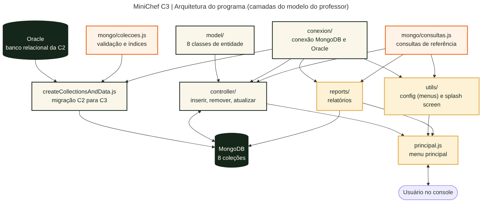

# MiniChef | Documento de Engenharia do Trabalho C3

**Banco de Dados Não Relacional (MongoDB).** Escopo, requisitos, arquitetura, design e instruções de implementação.

| Item | Dado |
|---|---|
| Disciplina | Banco de Dados, prof. Howard Roatti, semestre 2026/2 |
| Grupo | Carlos Henrique Forechi Schmittel, Cesar e Gabriel |
| Engenheiro responsável | Carlos Henrique Forechi Schmittel: escopo, arquitetura, modelagem, revisão técnica |
| Versão | 1.0, 16/11/2026 |
| Entrega | 04/12/2026, no AVA, com o link do GitHub |
| Documentos relacionados | `BANCO_DE_DADOS_C3.md` (dicionário das coleções e consultas) e `src/diagrams/` |

---

## Sumário

1. Objetivo
2. Escopo
3. Requisitos
4. Arquitetura
5. Design de dados
6. Design do programa
7. Fluxos de uso
8. Instruções de implementação
9. Plano de trabalho
10. Testes e critérios de aceite
11. Riscos
12. Rastreabilidade e avaliação

---

## 1. Objetivo

Migrar o banco relacional da C2, no Oracle da VM da disciplina, para o MongoDB, e adaptar o programa sem mudar o que o usuário vê. O MiniChef continua com o mesmo MVP:

- CRUD de receitas;
- planner semanal;
- calculadora de porções;
- lista de compras.

O trabalho entrega três coisas:
1. Os scripts do banco relacional no Oracle e um script que lê esse banco e cria as coleções com os mesmos dados (item 4 do edital).
2. Um programa de console com menu de relatórios, inserção, remoção e atualização sobre o MongoDB.
3. A documentação, o diagrama, o vídeo e o registro de uso de IA exigidos pelo edital.

---

## 2. Escopo

### Dentro do escopo

| Essencial (entrega da C3) | Desejável (se sobrar tempo) | Futuro (fora da C3) |
|---|---|---|
| Script de criação das 8 coleções, com validação e índices | Relatórios extras: ingredientes mais usados e planner da semana | Despensa, notícias, notificações, moderação |
| Scripts do banco relacional no Oracle e script de migração do Oracle para o MongoDB | Calculadora de porções e geração da lista de compras no menu | Orçamento: preços, custo estimado e total da lista |
| Menu com relatórios, inserir, remover, atualizar e sair | Cores no console | Tipos de conta além de usuário comum e administrador |
| Splash screen com a contagem de documentos | Exportar relatório em texto | Interface gráfica ou web |
| Relatório de agrupamento e relatório de junção | | |
| CRUD das 8 coleções, com checagem de filhos na remoção | | |
| Diagrama relacional, README.MD, PROMPTS.md, vídeo | | |

### Fora do escopo
- Conversão de unidades (g para kg).
- Login e senha no programa de console.
- Transações entre coleções. O MongoDB da VM roda como servidor único (seção 11).

### Premissas
- O programa da C2 está funcionando, e o grupo reaproveita o código (confirmado pelo Carlos em 09/11/2026).
- A divisão de papéis é a mesma da C2 (confirmado pelo Carlos em 09/11/2026).
- A origem da migração é o Oracle, como manda o item 4.I do edital. O modelo é o mesmo da C2, recriado no Oracle por `src/sql/01_create_tables_oracle.sql` e `02_insert_samples_oracle.sql`.
- A VM da disciplina precisa ter Node.js, Oracle e MongoDB. O Cesar confere isso no primeiro marco do plano.

---

## 3. Requisitos

### Requisitos funcionais

| Código | Requisito | Origem no edital |
|---|---|---|
| RF00 | Criar o banco relacional no Oracle, com as tabelas e os registros da C2 | 4.I e 4.V |
| RF01 | Criar uma coleção com o mesmo nome de cada tabela da C2 | 4.IV |
| RF02 | Conectar ao Oracle e ao MongoDB, consultar cada tabela e copiar os registros para a coleção | 4.I a 4.V |
| RF03 | Exibir splash screen com o nome do sistema, os integrantes, o total de documentos por coleção, a disciplina, o semestre e o professor | 6.c, 6.d e Etapa 5 |
| RF04 | Exibir o menu principal (relatórios, inserir, remover, atualizar, sair) sempre que uma ação terminar | 6.a e 6.f |
| RF05 | Relatório de agrupamento: receitas por refeição, com total, tempo médio e orçamento médio | 7.a.1.i |
| RF06 | Relatório de junção: ficha de ingredientes de cada receita, com o autor | 7.a.1.ii |
| RF07 | Inserir: escolher a entidade, pedir cada atributo, inserir e perguntar se continua | 7.b |
| RF08 | Remover: escolher a entidade, listar id e nome, confirmar, checar filhos e perguntar se continua | 7.c |
| RF09 | Atualizar: escolher a entidade, listar, pedir os campos, atualizar, exibir o documento e perguntar se continua | 7.d |
| RF10 | Antes de inserir, conferir que o documento ainda não existe e que o pai existe. Antes de alterar ou remover, conferir que o documento existe | Etapa 3 |

### Requisitos não funcionais

| Código | Requisito | Critério |
|---|---|---|
| RNF01 | Rodar na VM Linux da disciplina | README seguido do zero funciona |
| RNF02 | Usar só o driver oficial `mongodb`, sem biblioteca que monte consultas | `package.json` só com `mongodb` e `oracledb`, este usado só na migração |
| RNF03 | Seguir a orientação a objetos do projeto de exemplo | Classes de modelo com getters, setters e `toString`, e associação por instância |
| RNF04 | Ter interface amigável no console | Menus numerados, mensagens claras, nenhum erro técnico cru na tela |
| RNF05 | Não quebrar com entrada inválida | Valor inválido gera nova pergunta, não encerra o programa |
| RNF06 | Manter a integridade sem chave estrangeira | Nenhum documento filho aponta para pai inexistente |

---

## 4. Arquitetura

O programa segue as camadas do esquema do edital ("Esquema do projeto no GitHub"). A pasta `mongo/` guarda o esquema das coleções e as consultas de referência, usadas pelas camadas de cima.



| Camada | Pasta | Responsabilidade | Dono |
|---|---|---|---|
| Conexão | `src/conexion/` | Abrir e fechar a conexão com o MongoDB e, na migração, com o Oracle | Cesar |
| Modelo | `src/model/` | Uma classe por coleção, com atributos, getters, setters e `toString` | Cesar |
| Controle | `src/controller/` | Inserir, remover e atualizar cada entidade, com as checagens de existência | Cesar |
| Banco relacional | `src/sql/` | Criação das tabelas e registros de exemplo no Oracle | Carlos |
| Esquema e consultas | `src/mongo/` | Validação, índices, conversão Oracle para MongoDB e consultas prontas | Carlos |
| Relatórios | `src/reports/` | Executar e exibir os relatórios | Gabriel |
| Utilitários | `src/utils/` | Menus (`config.js`) e splash screen | Gabriel |
| Principal | `src/principal.js` | Ponto de entrada e fluxo do menu | Gabriel |
| Migração | `src/createCollectionsAndData.js` | Criar as coleções e copiar os dados da C2 | Cesar |

### Fluxo de dados
1. **Migração, rodada uma vez:** Oracle → `createCollectionsAndData.js` → `criarColecoes()` → `linhaOracleParaDocumento()` → `insertMany` em cada coleção.
2. **Uso normal:** Usuário → `principal.js` → controller ou relatório → driver `mongodb` → coleção.

### Tecnologia

| Item | Escolha | Motivo |
|---|---|---|
| Linguagem | JavaScript (Node.js) | Mesma da C2. O código existente é reaproveitado |
| Driver MongoDB | `mongodb` (oficial) | Exigência do edital |
| Driver Oracle | `oracledb` (oficial, modo Thin) | Lê o banco relacional na migração, sem instalar o Oracle Client |
| Entrada no console | `readline` (nativo do Node.js) | Não acrescenta dependência |
| Banco | `minichef` no MongoDB local da VM | Configurável por `MONGO_URL` e `MONGO_DB` |

---

## 5. Design de dados

O detalhe de cada campo está em `BANCO_DE_DADOS_C3.md`. Aqui ficam as decisões.

| Decisão | Opção escolhida | Alternativa descartada | Motivo |
|---|---|---|---|
| Estrutura | Uma coleção por tabela, ligadas por referência | Itens embutidos dentro do pai | O item 4 do edital exige uma coleção com o nome de cada tabela. Mantém o CRUD de cada entidade |
| Identificador | Campo `id` inteiro, igual ao da C2 | Usar só o `_id` (ObjectId) | Menus com números curtos e referências iguais às da C2 |
| Novo id | Maior `id` + 1 (`proximoId`) | Coleção de contadores | É a estratégia do projeto de exemplo. Basta para um programa com um usuário por vez |
| Validação | `$jsonSchema` com os NOT NULL e CHECK da C2 | Sem validação | O banco recusa documento inválido |
| Unicidade | Índices únicos em `id`, `email`, `cpf` e nome do ingrediente (sem diferenciar maiúsculas) | Checar só no programa | A regra vale mesmo se o programa falhar |
| Integridade | Checagem dos filhos no programa, com a tabela de dependências | Nenhuma | O MongoDB não tem chave estrangeira. Item 7.c.5.i do edital |
| Campos futuros | Presentes com `null` | Omitir | O banco não muda quando a função chegar |

**Coleções e relacionamentos:**

| Coleção | Pai(s) | Regra ao remover o pai |
|---|---|---|
| `usuario` | (nenhum) | |
| `ingrediente` | (nenhum) | |
| `receita` | `usuario` | Bloqueia |
| `receita_ingrediente` | `receita`, `ingrediente` | Cascata pela receita, bloqueia pelo ingrediente |
| `planner_semanal` | `usuario` | Cascata |
| `item_planner` | `planner_semanal`, `receita` | Cascata pelo planner, bloqueia pela receita |
| `lista_compras` | `planner_semanal` | Cascata |
| `item_lista_compras` | `lista_compras`, `ingrediente` | Cascata pela lista, bloqueia pelo ingrediente |

---

## 6. Design do programa

### Classes de modelo (`src/model/`)

A orientação do edital diz: "sempre que um objeto possui uma associação com outro, a classe deverá ter como atributo uma instância do outro objeto, não apenas seu atributo".

| Classe | Atributos de associação (instância, não id) |
|---|---|
| `Usuario` | (nenhum) |
| `Ingrediente` | (nenhum) |
| `Receita` | `autor: Usuario` |
| `ReceitaIngrediente` | `receita: Receita`, `ingrediente: Ingrediente` |
| `PlannerSemanal` | `usuario: Usuario` |
| `ItemPlanner` | `planner: PlannerSemanal`, `receita: Receita` |
| `ListaCompras` | `planner: PlannerSemanal` |
| `ItemListaCompras` | `lista: ListaCompras`, `ingrediente: Ingrediente` |

Cada classe tem getters, setters e `toString()`. Na gravação, o controller converte a instância no id. Por exemplo, `receita.getAutor().getId()` vira `autor_id`.

### Controllers (`src/controller/`)

Um controller por entidade. Em cada método, a conexão com o MongoDB é aberta antes de executar os comandos (Etapa 3 do edital). Cada controller tem:

| Método | Faz | Usa |
|---|---|---|
| `inserir()` | Exibe cada atributo, pede os valores, confere o pai, gera o id, insere e devolve o objeto | `atributosDaColecao`, `existe`, `proximoId`, `insertOne` |
| `atualizar()` | Lista, pede o id, confere se existe, pede os campos, atualiza e exibe | `listarDocumentos`, `existe`, `atualizarDocumento` |
| `excluir()` | Lista, pede o id, confere se existe, confirma, checa os filhos e remove | `listarDocumentos`, `existe`, `verificarFilhos`, `removerComFilhos` |
| `existe(id)` | Diz se o documento existe | `existe(db, colecao, id)` |

### Menus (`src/utils/config.js`)

```
MENU PRINCIPAL               ENTIDADES
1 - Relatórios               1 - Usuário
2 - Inserir documentos       2 - Ingrediente
3 - Remover documentos       3 - Receita
4 - Atualizar documentos     4 - Ingrediente da receita
0 - Sair                     5 - Planner semanal
                             6 - Item do planner
RELATÓRIOS                   7 - Lista de compras
1 - Receitas por refeição    8 - Item da lista de compras
2 - Ficha de ingredientes    0 - Voltar
0 - Voltar
```

### Splash screen (`src/utils/splashScreen.js`)

Mantém o professor, a disciplina e o semestre, como pede a Etapa 5. Contagem com os dados de exemplo da C2 (ilustrativa):

```
########################################################
#                  MINICHEF | C3 MONGODB               #
#                                                      #
#  TOTAL DE DOCUMENTOS EXISTENTES                      #
#     1 - USUARIO:                 4                   #
#     2 - INGREDIENTE:            12                   #
#     3 - RECEITA:                 6                   #
#     4 - RECEITA_INGREDIENTE:    21                   #
#     5 - PLANNER_SEMANAL:         2                   #
#     6 - ITEM_PLANNER:            6                   #
#     7 - LISTA_COMPRAS:           0                   #
#     8 - ITEM_LISTA_COMPRAS:      0                   #
#                                                      #
#  CRIADO POR: CARLOS HENRIQUE FORECHI SCHMITTEL       #
#              CESAR                                   #
#              GABRIEL                                 #
#                                                      #
#  DISCIPLINA: BANCO DE DADOS                          #
#              2026/2                                  #
#  PROFESSOR: HOWARD ROATTI                            #
########################################################
```

### Tratamento de erros

| Situação | Comportamento |
|---|---|
| Documento recusado pela validação (código 121) | "Dados inválidos: confira os campos obrigatórios e os valores permitidos." e nova tentativa. A função `mensagemErro(erro)` devolve o texto de cada caso |
| Valor repetido em índice único (código 11000) | "Já existe um registro com este valor (e-mail, CPF ou nome do ingrediente)." |
| Pai inexistente | "Não existe <entidade> com o id informado." |
| Id inexistente ao remover ou atualizar | "Registro não encontrado." e volta à listagem |
| MongoDB fora do ar | Mensagem na splash e encerramento limpo |

---

## 7. Fluxos de uso

### Inserir (RF07, RF10)
1. O menu de entidades é exibido, e o usuário escolhe uma.
2. O programa pede cada atributo. Em campos de referência, lista os pais disponíveis.
3. Confere se o pai existe e gera o id com `proximoId`.
4. Insere o documento e mostra o `toString()` do objeto.
5. Pergunta "Deseja continuar inserindo? (S/N)". **S** volta ao passo 1 ou repete a entidade. **N** volta ao menu principal.

### Remover (RF08)
1. O usuário escolhe a entidade, e o programa lista `id` e `nome` (ou outro campo descritivo).
2. O usuário informa o id, e o programa confere se ele existe.
3. Pergunta "Confirma a remoção? (S/N)". **N** volta ao menu principal.
4. Roda `verificarFilhos`:
   - Se algum filho tiver regra **Bloqueia**, informa a coleção e o total e não remove.
   - Se houver filhos com regra **Cascata**, pergunta se remove junto. Se a resposta for **S**, roda `removerComFilhos`.
   - Se não houver filhos, remove.
5. Pergunta "Deseja remover mais algum? (S/N)".

### Atualizar (RF09)
1. O usuário escolhe a entidade, e o programa lista os documentos.
2. O usuário informa o id, e o programa confere se ele existe.
3. O usuário escolhe o campo a alterar (exceto `id`) e informa o novo valor. Se o campo for de referência, o programa confere o pai.
4. Roda `atualizarDocumento` e exibe o documento atualizado.
5. Pergunta "Deseja atualizar mais algum? (S/N)".

### Relatórios (RF05, RF06)
1. O usuário escolhe o relatório, e o programa executa o pipeline.
2. Exibe o resultado em tabela (`console.table`) e espera Enter para voltar.

---

## 8. Instruções de implementação

### Ordem de trabalho
1. **Todos:** fazem fork do projeto de exemplo (`howardroatti/example_crud_mongo`) e o analisam antes de começar (edital 10.a). O código do grupo é próprio: o edital não aceita cópia, exceto do exemplo.
2. **Carlos:** cria o repositório novo, adiciona Cesar, Gabriel e `howardroatti` como colaboradores e sobe o esqueleto de pastas, `src/sql/`, `src/mongo/`, `src/diagrams/`, `src/docs/` e `PROMPTS.md`.
3. **Cesar:** cria o banco no Oracle da VM com `src/sql/01` e `02`, depois faz a conexão e a migração. A migração precisa rodar na VM antes de qualquer outra parte.
4. **Cesar:** classes de modelo e controllers. Começa por `ingrediente` e `usuario`, que não têm pai.
5. **Gabriel:** `config.js`, splash screen, relatórios e `principal.js`, ligando os controllers à medida que ficam prontos.
6. **Grupo:** testes da seção 10 na VM.
7. **Cesar:** README. **Gabriel:** vídeo. **Carlos:** revisão final.

### Migração: pontos obrigatórios
- Ordem: `usuario`, `ingrediente`, `receita`, `receita_ingrediente`, `planner_semanal`, `item_planner`, `lista_compras`, `item_lista_compras`.
- Rodar os scripts do Oracle com `export NLS_LANG=AMERICAN_AMERICA.AL32UTF8`, senão os acentos são gravados errado e a validação do MongoDB recusa valores como "Almoço".
- Consultar com `outFormat: oracledb.OUT_FORMAT_OBJECT` e converter cada linha com `linhaOracleParaDocumento(tabela, linha)`. Ela passa os nomes de coluna para minúsculas e transforma os `NUMBER(1)` (0 ou 1) em `true` ou `false`.
- Rodar a migração e o programa no mesmo fuso horário da VM, para as datas não mudarem de dia.
- Chamar `criarColecoes(db)` antes de inserir.

### Convenções
| Item | Regra |
|---|---|
| Nomes de campo | Os mesmos da C2, em `snake_case` |
| Classes | `PascalCase`, um arquivo por classe |
| Commits | Pequenos, com mensagem em português que diz o que mudou. Cada integrante faz commits com a própria conta |
| Configuração | `MONGO_URL`, `MONGO_DB`, `ORACLE_USER`, `ORACLE_PASSWORD` e `ORACLE_CONNECT` em variáveis de ambiente, nunca senha no código |
| Prompts de IA | Cada integrante registra os próprios no `PROMPTS.md`: prompt, ferramenta e o que fez com a resposta |

### README.MD (Cesar)
1. Objetivo do sistema.
2. Pré-requisitos na VM: Node.js, Oracle e MongoDB.
3. Criação do banco relacional: `sqlplus` com `src/sql/01_create_tables_oracle.sql` e `02_insert_samples_oracle.sql`.
4. Instalação: `cd src && npm install`.
5. Migração: `node createCollectionsAndData.js`.
6. Execução: `node principal.js`.
7. Estrutura de pastas.
8. Link do vídeo.
9. Integrantes.

### Vídeo (Gabriel)
Mostrar, nesta ordem: o objetivo do sistema, a splash, os dois relatórios e inserir, remover e atualizar. Na remoção, mostrar um caso bloqueado e um caso em cascata. Mostrar também a pergunta de continuar em cada fluxo. O edital pede todos os menus em funcionamento e não pede explicação do código.

---

## 9. Plano de trabalho

Marcos até a entrega, combinados com o grupo.

| Data | Marco | Responsável |
|---|---|---|
| 18/11 | Repositório novo criado, com colaboradores, esqueleto e arquivos de engenharia e modelagem | Carlos |
| 19/11 | Fork e análise do projeto de exemplo | Todos |
| 20/11 | Banco relacional criado no Oracle da VM (teste T00) | Cesar |
| 21/11 | Migração rodando na VM, com contagem igual à seção 10 | Cesar |
| 25/11 | Classes de modelo e controllers das 8 entidades | Cesar |
| 27/11 | Menus, splash e relatórios ligados | Gabriel |
| 29/11 | Testes da seção 10 aprovados na VM | Grupo |
| 01/12 | README e vídeo publicados | Cesar e Gabriel |
| 02/12 | Revisão final contra a seção 12 | Carlos |
| 04/12 | Link postado no AVA | Carlos |

Questionário C3.A1 (individual): de 30/11 a 06/12, até 22h.

---

## 10. Testes e critérios de aceite

Os testes rodam na VM, com os dados de exemplo da C2 (ilustrativos).

| Caso | Passos | Resultado esperado |
|---|---|---|
| T00 Banco Oracle | Rodar `src/sql/01` e `02` no `sqlplus` | 8 tabelas e 51 registros, com acentos corretos (`SELECT nome FROM ingrediente`) |
| T01 Migração | Rodar `createCollectionsAndData.js` | 8 coleções. Contagem: 4, 12, 6, 21, 2, 6, 0, 0 |
| T02 Splash | Rodar `principal.js` | Nome, contagem, integrantes, disciplina, 2026/2 e professor |
| T03 Agrupamento | Relatórios > 1 | Almoço 3, Café da manhã 1, Jantar 1, Lanche 1 |
| T04 Junção | Relatórios > 2 | 21 linhas, cada uma com receita, autor e ingrediente |
| T05 Inserir | Inserir o ingrediente "Sal" | Novo id 13. Splash passa a mostrar 13 |
| T06 Duplicado | Inserir o ingrediente "tomate" | Recusado: o nome já existe ("Tomate") |
| T07 Pai inexistente | Inserir uma receita com `autor_id` 99 | Recusado com mensagem |
| T08 Remover bloqueado | Remover a receita 1 | Bloqueado: 2 itens de planner usam a receita |
| T09 Remover em cascata | Remover o planner 2 e confirmar | Planner e 1 item removidos |
| T10 Atualizar | Mudar a categoria do ingrediente 12 | Documento exibido com a nova categoria |
| T11 Entrada inválida | Digitar letra no lugar do número de porções | Pergunta de novo, sem encerrar |
| T12 Continuar | Responder S e depois N em cada fluxo | S repete, N volta ao menu principal |
| T13 Lista de compras (desejável) | Gerar a lista do planner 1 | Alho 13 dente, Arroz 1200 g, Azeite 65 ml, Cebola 4, Feijão 500 g, Ovo 4, Frango 800 g |

**Critério de aceite geral:** T00 a T12 aprovados na VM, README seguido do zero por alguém do grupo e vídeo com todos os menus.

---

## 11. Riscos

| Risco | Impacto | Mitigação |
|---|---|---|
| Diferença entre o ambiente de desenvolvimento e a VM | Alto | T01 a T04 na VM até 21/11. Os resultados esperados vêm das mesmas consultas em SQL no banco relacional |
| 8 entidades para converter em 18 dias | Alto | O edital exige no mínimo 2. Se 27/11 chegar sem tudo pronto, entregar completas `usuario`, `ingrediente`, `receita` e `receita_ingrediente` e deixar as demais para a versão seguinte |
| Sem transação: lista criada e itens não inseridos se houver erro no meio | Baixo | `gerarListaCompras` remove a lista criada se a inserção dos itens falhar |
| `proximoId` pode repetir com dois usuários ao mesmo tempo | Baixo | Programa de console de um usuário. O índice único recusa a repetição |
| Oracle da VM sem suporte a `IDENTITY` (versão anterior à 12c) | Médio | O Cesar confere a versão com `SELECT banner FROM v$version` no teste T00. Se for antiga, trocar `IDENTITY` por uma sequence |
| Integrante sem commit | Alto (nota zero individual) | Cada um sobe os próprios arquivos com a própria conta |
| `PROMPTS.md` incompleto | Médio | Cada integrante preenche a própria seção antes de 02/12 |

---

## 12. Rastreabilidade e avaliação

| Nota | Item do edital | Requisito | Entregável | Dono |
|---|---|---|---|---|
| 1,5 | Relatórios (7.a) | RF05, RF06 | `src/reports/` | Gabriel |
| 1,5 | Inserir (7.b) | RF07, RF10 | `src/controller/` | Cesar |
| 1,5 | Remover (7.c) | RF08, RF10 | `src/controller/` | Cesar |
| 1,5 | Atualizar (7.d) | RF09, RF10 | `src/controller/` | Cesar |
| 0,5 | Diagrama relacional | | `src/diagrams/` | Carlos |
| 0,5 | Interface amigável | RF03, RF04, RNF04 | `src/utils/`, `principal.js` | Gabriel |
| 0,5 | Vídeo no YouTube | | Link no README | Gabriel |
| 0,5 | README.MD para Linux | RNF01 | Raiz | Cesar |
| | Script de criação das coleções (8.a.i) | RF01 | `src/mongo/colecoes.js` | Carlos |
| | Banco relacional no Oracle (item 4.I) | RF00 | `src/sql/` | Carlos |
| | Script de migração (item 4) | RF01, RF02 | `src/createCollectionsAndData.js` | Cesar |
| | PROMPTS.md (observação 5) | | Raiz | Todos |
| | Professor colaborador (observação 6) | | Configuração do repositório | Carlos |

**Total: 8,0 pontos.** Sem seguir o edital, a nota é zero. Cada dia de atraso tira 0,5.
